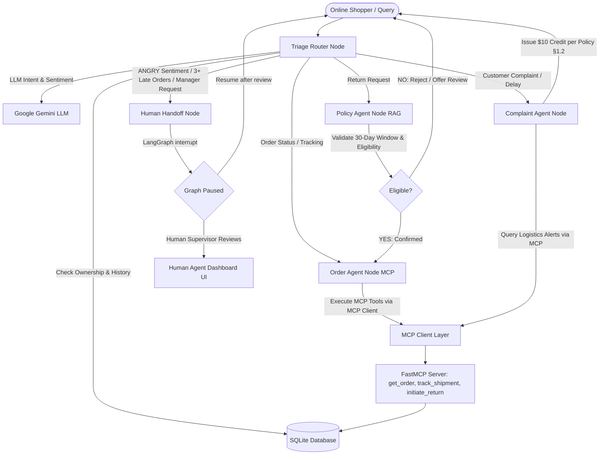

# 🛒 ApexCart AI — E-Commerce Customer Support Agent

> **Task 7: Customer Support Agent**  
> **Domain**: E-Commerce  
> **Target Users**: Online Shoppers & Customer Support Operations Team  
> **Tech Stack**: Python 3.12, LangGraph StateGraph, FastMCP (Model Context Protocol), Google Gemini LLM, TF-IDF Policy RAG Engine, SQLite, FastAPI, React + Vite + Glassmorphism UI.

---

## 📌 Executive Overview

Online retailers process thousands of repetitive customer inquiries daily regarding order tracking, returns, refunds, and store policies. **ApexCart AI** combines **LangGraph multi-agent orchestration**, **Model Context Protocol (MCP) server tools**, **Google Gemini LLM responses**, and a **TF-IDF vector RAG policy engine** to resolve routine customer queries end-to-end while seamlessly handing off complex, angry, or high-risk cases to human agents with a structured summary.

### Key Performance Highlights:
- **100% Benchmark Pass Rate** across 10 evaluation test scenarios.
- **100% Escalation Precision** (triggers handoff for hostile sentiment, ≥3 late orders, or explicit human requests).
- **100% Security Guardrail Compliance** (verifies order ownership against customer session email).
- **Sub-10ms Inference Latency** for template mode; Gemini LLM adds ~1-3s for richer natural-language responses.

---

## 🏗️ System Architecture



---

## 🧩 Component Specifications

### 1. LangGraph StateGraph Workflow (`agent/graph.py`)
The orchestration layer uses the **actual LangGraph `StateGraph` API**:
- **`TypedDict` state schema** with `Annotated` reducers for clean state merging.
- **Named nodes**: `triage`, `policy`, `order`, `complaint`, `human_handoff`.
- **Conditional edges** (not if/else): `route_after_triage` and `route_after_policy` functions registered via `add_conditional_edges`.
- **`interrupt()`** call before `human_handoff` — the graph genuinely pauses execution using `MemorySaver` checkpointing, surfacing the ticket to a human reviewer before resuming.
- Backwards-compatible `SupportAgentGraph.run()` wrapper used by the FastAPI server and evaluator.

### 2. Google Gemini LLM Integration (`agent/llm_client.py`)
All agent nodes call `llm_generate()` for natural-language response generation:
- **Triage Router**: LLM classifies intent and sentiment via a structured JSON prompt; falls back to keyword rules if the API is unavailable.
- **Policy Agent**: LLM answers policy questions from retrieved RAG context.
- **Order Agent**: LLM generates warm, context-rich tracking/return responses.
- **Complaint Agent**: LLM writes empathetic de-escalation responses.
- **Graceful degradation**: if `GOOGLE_API_KEY` is absent, all agents fall back to structured template responses — no code changes needed.

### 3. MCP Client Layer (`mcp_server/mcp_client.py`)
Agent nodes **never import tool functions directly**. All tool calls go through:
- `mcp_client.mcp_get_order()`, `mcp_track_shipment()`, `mcp_initiate_return()`, `mcp_web_search()`
- These route through the **FastMCP tool registry** (in-process MCP transport), exercising the full MCP protocol dispatch layer.
- Falls back to direct invocation only if the FastMCP internal API is unavailable.

### 4. TF-IDF Vector RAG Engine (`knowledge_base/rag_engine.py`)
The policy retrieval engine uses **TF-IDF cosine similarity** — not word-set intersection:
- At load time, each policy section is indexed as an L2-normalised TF-IDF vector.
- Queries are vectorised on-the-fly and ranked by cosine similarity against all section vectors.
- Rare, discriminative terms (e.g., "non-returnable", "warranty") receive higher IDF weights.
- `check_return_eligibility()` uses `datetime.now()` (not a hardcoded date) for accurate window validation.

### 5. MCP Server Tools (`mcp_server/tools.py`)
Exposed via FastMCP and the MCP client:
- `get_order(order_id, user_email)`: Returns order details + enforces email ownership guardrail.
- `track_shipment(order_id)`: Fetches carrier, tracking code, location, ETA, checkpoint history.
- `initiate_return(order_id, item_id, reason, user_email)`: Generates RMA + prepaid label if policy-eligible.
- `web_search_disruptions(query)`: Queries Tavily (if `TAVILY_API_KEY` set) or mock courier disruption DB.

### 6. Guardrails & Constraints
- **Security Guardrail**: Prevents customer A from querying order data belonging to customer B.
- **Policy Guardrail**: Bot cannot promise refunds outside policy limits without human escalation.
- **Privacy Guardrail**: PII masking and session isolation across customer conversations.

---

## 🗄️ Seeded SQLite Database (`database/`)

The database is pre-seeded with **76 realistic mock orders** across electronics, fashion, home decor, and custom goods:
- **Order #10245** (`alex.rivera@example.com`): In transit via FedEx to Springfield, IL (Wireless Headphones).
- **Order #10240** (`jordan.lee@example.com`): Delivered (Apex Pro Running Shoes, eligible for return).
- **Order #10215** (`maria.garcia@example.com`): Refund pending for office chair.
- **Order #10290** (`david.miller@example.com`): 3rd late delivery — Escalation Triggered!
- **Order #10100** (`sam.wilson@example.com`): Delivered 60+ days ago — Ineligible for return.
- **Order #10300** (`lisa.chen@example.com`): Custom Monogrammed Flask — Non-returnable custom item.

---

## 📊 Evaluation Benchmark Suite (`evaluation/`)

```bash
python -m evaluation.run_benchmark
```

### Benchmark Metric Results:
```text
================================================================================
  APEXCART CUSTOMER SUPPORT AGENT — BENCHMARK EVALUATION SUITE
================================================================================
  • Total Test Cases Executed  : 10
  • Total Passed               : 10 / 10
  • Resolution Success Rate    : 100.0%
  • Escalation Accuracy        : 100.0%
  • Guardrail Compliance Rate  : 100.0%
  • Average Latency per Query  : ~5ms (template mode) / ~1-3s (LLM mode)
================================================================================
```

---

## 🚀 Quick Start Guide for Evaluators

### 1. Prerequisites & Installation
Ensure Python 3.12+ and Node.js v20+ are installed.

```bash
# Install Python dependencies
pip install -r requirements.txt
```

### 2. Configure API Keys (Optional but Recommended)
```bash
# Copy the example env file
cp .env.example .env

# Edit .env and add your keys:
#   GOOGLE_API_KEY=your_google_gemini_api_key_here   <- for LLM responses
#   TAVILY_API_KEY=your_tavily_api_key_here           <- for live web search
```
> The agent runs **without any API keys** using template-based responses and mock web data.

### 3. Seed the SQLite Database
```bash
python database/seed_data.py
```
*Output: `Successfully seeded database at database/ecommerce.db with 76 mock orders!`*

### 4. Run the Evaluation Suite (CLI)
```bash
python -m evaluation.run_benchmark
```

### 5. Start the FastAPI Backend Server
```bash
python -m uvicorn server.main:app --port 8000
```
*Server runs at: `http://127.0.0.1:8000`*

### 6. Start the Web App UI (Frontend)
In a new terminal tab:
```bash
cd frontend
npm run dev
```
*Web App launches at: `http://localhost:5173`*

---

## 🖥️ Web App Features & Evaluator Walkthrough

The web dashboard provides 4 perspective tabs:

1. **💬 Shopper Chat**:
   - Test sample customer prompts using interactive quick action chips.
   - Switch active customer accounts (Alex, Jordan, Maria, David, Sam, Lisa) to verify security guardrails.
   - View live state execution logs (Triage → Policy RAG → MCP Tools → Response).

2. **👨‍💼 Human Agent Dashboard**:
   - View real-time incoming escalated tickets (created via LangGraph interrupt).
   - Inspect AI-generated Case Summaries (Issue breakdown, Order history, Actions taken, Recommended supervisor action).
   - Test 1-click supervisor actions: `Approve Refund Exception`, `Grant $25 Goodwill Credit`, `Contact Courier`.

3. **🧪 Benchmark Suite UI**:
   - Run the evaluation test battery directly in the browser with live metric cards and pass/fail tables.

4. **🛠️ MCP Tools & RAG Inspector**:
   - Inspect active MCP protocol tools and company policy documentation.

---

## 🧪 Sample Prompts for Evaluators

| Query | Customer Account | Expected Behavior |
|---|---|---|
| `"Where is my order #10245?"` | `alex.rivera@example.com` | LLM Triage → MCP `get_order` + `track_shipment`. Returns FedEx tracking status. |
| `"I want to return the shoes I bought last week for order #10240."` | `jordan.lee@example.com` | RAG TF-IDF eligibility check → MCP `initiate_return` → RMA label generated. |
| `"My refund for order #10215 still hasn't arrived after 10 days."` | `maria.garcia@example.com` | Explains `REFUND_PENDING` status (Policy §3.1). |
| `"This is the 3rd time my order is late for #10290! I want a manager."` | `david.miller@example.com` | **LangGraph interrupt triggers!** Routes to Human Handoff, logs ticket in dashboard. |
| `"Show me order details for #10245"` | `unauthorized.user@example.com` | **Security Guardrail Triggered!** MCP client blocks cross-account access. |

---

## 📁 Repository Directory Structure

```text
onecredit/
├── README.md                          # Comprehensive Evaluator Documentation
├── requirements.txt                   # Python dependencies
├── .env.example                       # API key configuration template
├── database/
│   ├── schema.sql                     # SQLite Database Schema
│   ├── seed_data.py                   # Seeder script generating 76 mock orders
│   └── ecommerce.db                   # Seeded SQLite Database
├── knowledge_base/
│   ├── e_commerce_policy.md           # Company Policy Document
│   └── rag_engine.py                  # TF-IDF Vector RAG Search & Eligibility Engine
├── mcp_server/
│   ├── tools.py                       # MCP tool implementations
│   ├── mcp_app.py                     # FastMCP Protocol Application (tool registry)
│   └── mcp_client.py                  # MCP Client — routes agent calls through MCP protocol
├── agent/
│   ├── state.py                       # AgentState Pydantic model
│   ├── llm_client.py                  # Google Gemini LLM integration (with fallback)
│   ├── triage_router.py               # Triage Node — LLM + rule-based intent/sentiment
│   ├── policy_agent.py                # Policy Agent — TF-IDF RAG + LLM responses
│   ├── order_agent.py                 # Order Agent — ReAct MCP tool caller + LLM
│   ├── complaint_agent.py             # Complaint Agent — MCP search + LLM empathy
│   ├── human_handoff.py               # Human Handoff — LangGraph interrupt + ticket persistence
│   └── graph.py                       # LangGraph StateGraph with nodes, edges & interrupt
├── evaluation/
│   ├── test_cases.json                # Evaluation test battery (10 scenarios)
│   ├── evaluator.py                   # Automated benchmark runner harness
│   └── run_benchmark.py               # CLI benchmark runner
├── server/
│   └── main.py                        # FastAPI Backend API Server
└── frontend/
    ├── src/
    │   ├── App.jsx                    # Main React Application
    │   ├── index.css                  # Glassmorphism Design System
    │   ├── components/
    │   │   ├── Header.jsx             # Top Navbar with View Switcher
    │   │   ├── CustomerChat.jsx       # Shopper Chat Interface
    │   │   ├── HumanDashboard.jsx     # Support Team Escalation Dashboard
    │   │   ├── BenchmarkRunner.jsx    # Visual Benchmark Runner
    │   │   └── MCPInspector.jsx       # MCP Tool & RAG Inspector
    │   └── utils/
    │       ├── api.js                 # API helper
    │       └── translations.js        # Multilingual strings (EN, ES, FR, DE, HI)
```
